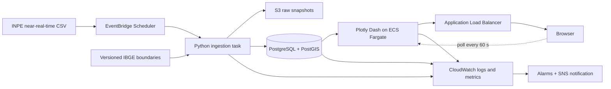

# Project Plan: QueimAlerta Brazil Wildfire Dashboard

## 1. Goal

Build an interactive Python dashboard that displays near-real-time active-fire detections across Brazil, lets users monitor trends and hotspots by geography and time, and exposes the operational health of the data pipeline and application.

The dashboard must describe satellite observations as **active-fire detections/hotspots**, not automatically as confirmed wildfires. A satellite detection can represent a wildfire, controlled burn, agricultural fire, industrial heat source, or false positive.

## Implementation status — 29 October 2026

The first working vertical slice is complete:

- Python 3.12 package and environment configuration.
- Official INPE Brazil daily-feed discovery, download, validation, and raw snapshot archive.
- Idempotent SQLAlchemy persistence for SQLite and PostgreSQL.
- Interactive Plotly Dash map, period/state/biome/satellite filters, KPI cards, timeline, state ranking, and recent-detection table.
- Data-freshness banner, ingestion monitoring panel, structured JSON logs, and separate live/ready/data health endpoints.
- Dockerfile and PostgreSQL/PostGIS Docker Compose definition for environments where Docker is available.
- Real-data validation with 10,536 detections. An immediate source replay inserted zero duplicate rows.

The next implementation slice is native PostGIS geometry and viewport queries, municipality filtering, richer point details/export, then AWS CDK, EventBridge scheduling, CloudWatch dashboards, alarms, and deployment controls.

## 2. Current workspace assessment

The workspace contains remnants of an earlier Flask prototype:

- `server/data/occurrences.json`: 27 static state totals with no coordinates, timestamps, confidence, or source provenance.
- `server/data/reports.json`: empty local report store.
- `server/__pycache__/app.cpython-312.pyc`: compiled backend only; maintainable Python source is missing.
- `server/_selftest_out.txt` and `server/_mtest_out.txt`: evidence of former API, health, report, and PWA behavior.
- `server/static/icons/`: reusable PWA icons.

The project should therefore be treated as a rebuild. The static totals can remain as clearly labeled demo fixtures, but must not be mixed with live detections.

## 3. Scope and assumptions

### MVP scope

- Brazil-wide interactive hotspot map.
- Automatic ingestion of INPE active-fire data every 10 minutes.
- Filters for period, state, municipality, biome, satellite, and confidence/quality fields when supplied by the source.
- Summary cards, trend chart, state/municipality ranking, and hotspot detail panel.
- Automatic browser refresh without a full page reload.
- Visible data freshness and source status.
- Application and pipeline monitoring with logs, metrics, alarms, and health endpoints.
- Local Docker-based development and AWS deployment.
- Portuguese user interface, with code and technical documentation in English.

### Deferred from the MVP

- Predicting fire spread.
- Dispatch or emergency-response workflows.
- SMS/WhatsApp notifications.
- Native mobile applications.
- Public community reports. The former report concept can return after authentication, moderation, rate limiting, and clear separation from satellite data are designed.
- WebSockets. Ten-minute source refresh does not justify their complexity; browser polling is sufficient for the MVP.

### Meaning of “real time”

This product is near-real-time. INPE publishes open active-fire files in intervals described as near-real-time, as often as every 10 minutes. The interface will show both `observed_at` and `ingested_at` so users can see actual latency. NASA FIRMS can be used as a fallback or validation source, but its common NRT products can arrive within roughly three hours of observation.

## 4. Recommended technology

| Area | Choice | Reason |
|---|---|---|
| Language | Python 3.12 | Matches the surviving prototype artifact and has strong geospatial/data tooling. |
| Dashboard | Plotly Dash | Interactive maps, filters, callbacks, and timed refresh stay in Python. `dcc.Interval` supports periodic updates without full page refresh. |
| Charts/maps | Plotly tile maps plus GeoJSON boundaries | Interactive hotspot points, density views, and state choropleths. |
| Data processing | Pandas, GeoPandas, Shapely | CSV normalization and spatial assignment to state/municipality/biome. |
| Database | PostgreSQL with PostGIS | Durable storage, deduplication, spatial filters, and time-window queries. |
| Raw archive | Amazon S3 | Preserves each downloaded source file for audit and replay. |
| Ingestion | EventBridge Scheduler plus a Python container task | Runs independently from dashboard replicas and avoids duplicate schedulers inside the web app. Use Lambda container for small workloads or scheduled ECS Fargate if runtime/package size exceeds Lambda limits. |
| Web hosting | ECS Fargate behind an Application Load Balancer | Straightforward container deployment and scaling for a stateful Dash web process. |
| Observability | CloudWatch Logs, custom metrics, dashboards, alarms, SNS | Covers infrastructure, application behavior, pipeline freshness, and notification. |
| Infrastructure | AWS CDK in Python | Reproducible infrastructure while keeping the project Python-centered. |
| Local environment | Docker Compose | Runs dashboard and PostgreSQL/PostGIS consistently on Windows and CI. |

For a hackathon-only demo, PostgreSQL can run locally and the scheduled ingestion command can be started manually. The production target should not use JSON files as a shared database.

## 5. Data sources

### Primary: INPE Programa Queimadas

Use the official INPE open-data CSV feed as the authoritative source. INPE states that active-fire files are available across multiple time ranges, including near-real-time files refreshed as often as every 10 minutes: [INPE Dados Abertos](https://terrabrasilis.dpi.inpe.br/queimadas/portal/dados-abertos/).

During the technical spike, confirm:

1. Stable download URL and file naming rules.
2. Field definitions, timezone, satellite identifiers, and quality/confidence semantics.
3. Redistribution, attribution, and request-frequency terms.
4. How corrections or late-arriving records are represented.
5. Whether Brazil-only files are available or filtering must occur after download.

Do not hard-code an endpoint until those points are verified against the current feed.

### Geographic reference: IBGE

Use the official [IBGE Localities API](https://servicodados.ibge.gov.br/api/docs/localidades?versao=1) for identifiers/names and the [IBGE Geographic Mesh API](https://servicodados.ibge.gov.br/api/docs/malhas?versao=4) for simplified web boundaries. Pin downloaded boundary versions rather than fetching them on every page request.

### Optional fallback: NASA FIRMS

Use the official [FIRMS Area API](https://firms.modaps.eosdis.nasa.gov/api/area/) only as a fallback or cross-check because it requires a `MAP_KEY` and has different source fields and latency. Keep source records distinct; never silently merge duplicate detections from INPE and FIRMS.

## 6. Target architecture



### Data flow

1. Scheduler triggers ingestion every 10 minutes.
2. Worker downloads the latest INPE file with timeout, retries, and checksum.
3. Original response is stored in S3 with source timestamp and checksum.
4. Worker validates required columns, coordinates, timestamps, and Brazil bounds.
5. Records are normalized to UTC and enriched using pinned IBGE/biome geometries.
6. Database upsert deduplicates detections using a source-provided identifier or a documented composite key.
7. Worker publishes ingestion counts, rejected rows, duration, and freshness metrics.
8. Dash queries pre-aggregated views and recent point data.
9. The browser refreshes summary components every 60 seconds. User-selected filters persist.
10. If data is stale, the dashboard keeps the last valid dataset and displays an explicit warning.

## 7. Core user experience

### Main monitoring page

- Header: product name, “last successful update,” source, and freshness status.
- KPI cards: detections in 1 hour, 24 hours, and 7 days; affected states; most affected state; source latency.
- Interactive map:
  - Clustered points at national zoom.
  - Individual detections at local zoom.
  - Optional density/heat layer.
  - State choropleth toggle.
  - Click panel with observation time, coordinates, municipality, state, biome, satellite, and source quality fields.
- Filters: time window, region, state, municipality, biome, satellite/source, and confidence.
- Charts: detections over time, comparison by state, top municipalities, and daily change.
- Table: sortable/exportable filtered records with row limits and CSV export.

### System monitoring page

- Current feed state: healthy, delayed, stale, or unavailable.
- Last attempt, last success, last source observation, and end-to-end delay.
- Ingested/rejected/duplicate counts for recent runs.
- Dashboard request latency and error rate.
- Database connectivity and storage trend.
- Links to the CloudWatch operational dashboard and runbook for authorized operators.

### Accessibility and responsive behavior

- Do not communicate severity through color alone.
- Provide keyboard-accessible filters and text alternatives for map-derived summaries.
- Use a colorblind-safe sequential palette.
- Support desktop first, then a readable tablet/mobile layout.
- Display timestamps with timezone labels; store UTC and default display to Brasília time.

## 8. Data model

### `hotspot_detection`

- `id` UUID/internal key
- `source` and `source_record_id`
- `observed_at` UTC
- `ingested_at` UTC
- `latitude`, `longitude`, and PostGIS `geometry`
- `satellite`, `sensor`
- `confidence`/quality fields as nullable source-native values
- `frp` or other intensity field when available
- `country_code`, `region_id`, `state_code`, `municipality_id`, `biome`
- `raw_object_uri`, `raw_checksum`
- unique constraint on `(source, source_record_id)` or approved composite fingerprint

### `ingestion_run`

- `id`, `source`, `started_at`, `finished_at`, `status`
- `source_observed_max_at`
- `downloaded_count`, `inserted_count`, `updated_count`, `duplicate_count`, `rejected_count`
- `duration_ms`, `error_code`, sanitized `error_message`
- `raw_object_uri`, `checksum`

### Aggregates

Create indexed SQL/materialized views for hourly counts by state and municipality. Refresh them after successful ingestion. Map queries must apply a bounding box and maximum point count to prevent sending all Brazilian records to one browser.

## 9. Monitoring and alert plan

### Health endpoints

- `/health/live`: process is running; no external dependency checks.
- `/health/ready`: database query succeeds and schema is ready.
- `/health/data`: reports latest successful ingestion and source observation age.

### Structured logs

Emit JSON logs containing timestamp, severity, service, environment, request/run ID, duration, row counts, and sanitized error type. Never log secrets, credentials, complete source payloads, or precise end-user location.

### Metrics

- `ingestion_success` and `ingestion_failure`
- `ingestion_duration_seconds`
- `records_inserted`, `records_rejected`, `records_duplicate`
- `data_age_minutes` based on newest `observed_at`
- `last_success_age_minutes`
- dashboard request count, 4xx/5xx rate, and p50/p95 latency
- DB connection errors and query duration
- ECS CPU, memory, running task count; ALB target health; RDS CPU, storage, and connections

### Initial alarms

Thresholds must be tuned after a baseline week:

- Warning when no successful ingestion occurs for 30 minutes; critical at 60 minutes.
- Critical when two consecutive ingestion jobs fail.
- Warning when rejected records exceed 5% of downloaded rows.
- Critical when the dashboard 5xx rate exceeds 2% for 10 minutes.
- Warning when p95 response time exceeds 3 seconds for 15 minutes.
- Critical when there are no healthy ALB targets.
- Warning for low RDS free storage and sustained high CPU/connections.

Route critical alarms through SNS to the agreed email/chat destination. Every alarm needs an owner, runbook link, and recovery condition.

## 10. Security and reliability controls

- Store database credentials and API keys in AWS Secrets Manager or Parameter Store; never commit them.
- Place RDS in private subnets and restrict security groups to the ingestion and app tasks.
- Use TLS at the ALB, least-privilege IAM roles, encrypted S3/RDS storage, and restricted S3 public access.
- Validate all source fields and user filters at trust boundaries.
- Use parameterized SQL and read-only database credentials for the dashboard.
- Add retry with exponential backoff and jitter, but do not retry malformed files indefinitely.
- Make ingestion idempotent and retain the last valid data when the source is unavailable.
- Define S3 retention, database backups, recovery point objective, and recovery time objective before production launch.
- Add AWS WAF/rate limiting if the dashboard becomes public or attracts abusive traffic.

## 11. Delivery plan

### Phase 0: Discovery and source contract, 2–3 days

- Verify current INPE download mechanics, schema, attribution, and sample files.
- Define the exact meaning of each displayed field.
- Confirm audience, public/private access, AWS region, budget, alert recipients, and data retention.
- Record architecture decisions for Dash, PostGIS, refresh interval, and fallback policy.

**Exit:** approved source contract, wireframe, data dictionary, and measurable MVP acceptance criteria.

### Phase 1: Foundation and data ingestion, 4–5 days

- Create Python package, dependency lock, configuration model, and Docker Compose stack.
- Build INPE downloader, raw S3/local archive adapter, schema validation, normalization, and idempotent upsert.
- Load pinned IBGE boundaries and implement spatial enrichment.
- Add ingestion run records and command-line execution.

**Exit:** repeated runs ingest a real sample without duplicates and expose freshness/count metrics.

### Phase 2: Interactive dashboard, 5–6 days

- Build Dash shell, responsive layout, filters, KPI cards, and error/empty/loading states.
- Add point/cluster map, choropleth, timeline, rankings, detail panel, and bounded CSV export.
- Add 60-second component refresh while preserving filter and map state.
- Add visible source attribution and stale-data banner.

**Exit:** a user can explore Brazil, filter detections, inspect one hotspot, and see when the data was observed and loaded.

### Phase 3: Monitoring and resilience, 3–4 days

- Add live, ready, and data-health endpoints.
- Add JSON logging, correlation IDs, custom CloudWatch metrics, operational dashboard, and alarms.
- Implement retries, timeout handling, malformed-file quarantine, and last-known-good behavior.
- Write incident runbooks for stale source, failed ingestion, database issues, and unhealthy app tasks.

**Exit:** induced source/database failures are visible, alert correctly, and do not misrepresent stale data as current.

### Phase 4: AWS deployment and release, 4–5 days

- Define VPC, S3, RDS/PostGIS, scheduler/worker, ECS service, ALB, secrets, logs, dashboards, and alarms with Python CDK.
- Configure deployment pipeline, database migrations, backups, TLS, and DNS.
- Run performance, accessibility, security, and restore checks.
- Publish operator and user documentation.

**Exit:** production environment meets the acceptance criteria and has an owner-approved rollback procedure.

Estimated MVP: **3–4 weeks for one experienced engineer**, or **about 2 weeks with two engineers working in parallel**, excluding procurement, DNS, and organizational security approvals.

## 12. Suggested repository structure

```text
/
├── src/queimalerta/
│   ├── dashboard/          # Dash pages, callbacks, components
│   ├── ingestion/          # Scheduled job and validation pipeline
│   ├── sources/            # INPE, optional FIRMS adapters
│   ├── repositories/       # Postgres/PostGIS access
│   ├── geography/          # IBGE enrichment and pinned metadata
│   ├── observability/      # Logging, metrics, health checks
│   ├── domain/             # Models and shared rules
│   └── settings.py
├── migrations/
├── infra/                  # AWS CDK in Python
├── data/fixtures/          # Clearly labeled non-live samples
├── docs/                   # Data dictionary, ADRs, runbooks
├── tests/                  # Unit, integration, and smoke checks
├── Dockerfile
├── compose.yaml
├── pyproject.toml
├── .env.example
└── README.md
```

Keep the current `server/` directory unchanged until useful fixtures, API behavior, and icons are intentionally migrated. Do not derive production code from the compiled `.pyc` file.

## 13. Acceptance criteria

- The newest successful source ingestion appears on the dashboard within 15 minutes under normal source availability.
- Every displayed detection has source, observation time, ingestion time, coordinates, and provenance.
- Re-running the same source file creates no duplicate detection rows.
- Filters update all cards, map layers, charts, and tables consistently.
- National map interaction remains usable with clustering/aggregation and bounded query results.
- The dashboard visibly warns when the latest successful ingestion is older than 30 minutes.
- Health endpoints distinguish process, dependency, and data-freshness failures.
- A failed ingestion emits a structured error, metric, ingestion-run record, and alarm after the defined threshold.
- The dashboard p95 response time is at most 3 seconds under the agreed load profile.
- No secrets are present in source control or logs, and the dashboard database role is read-only.
- Documentation explains satellite-detection limitations and does not describe every hotspot as a confirmed wildfire.

## 14. Key risks and mitigations

| Risk | Mitigation |
|---|---|
| INPE URL/schema changes | Adapter layer, contract validation, raw archive, failure alarm, and documented manual replay. |
| Satellite latency or coverage gaps | Show observation time and freshness; explain limitations; optional FIRMS comparison without silent merging. |
| Too many points for browser rendering | Bounding-box queries, clustering, pre-aggregation, pagination, and hard point caps. |
| Spatial joins are slow | Enrich at ingestion, index PostGIS columns, and pin simplified boundaries. |
| Dashboard and worker disagree on state | Shared database schema/migrations; dashboard never schedules ingestion. |
| Users interpret hotspots as confirmed fires | Consistent terminology, methodology panel, source attribution, and quality fields. |
| AWS cost growth | Start with one small ECS task, right-size RDS, set log/S3 retention, budgets, and cost alarms. |
| Old static totals are mistaken for live data | Move them to labeled fixtures and exclude them from production queries. |

## 15. Decisions needed before implementation

1. Is the audience public, internal, or authenticated partners?
2. Is monitoring limited to satellite detections, or should moderated community reports return?
3. Which AWS account, region, domain, monthly budget, and alert channels should be used?
4. How long should raw files and normalized detections be retained?
5. Should the first release use INPE only, or include NASA FIRMS as a visibly separate fallback layer?
6. What traffic/load target defines the response-time acceptance test?

## Sources

- [INPE Programa Queimadas open data](https://terrabrasilis.dpi.inpe.br/queimadas/portal/dados-abertos/)
- [Brazilian government service for obtaining INPE fire data](https://www.gov.br/pt-br/servicos/obter-dados-de-queimadas)
- [IBGE Localities API](https://servicodados.ibge.gov.br/api/docs/localidades?versao=1)
- [IBGE Geographic Mesh API](https://servicodados.ibge.gov.br/api/docs/malhas?versao=4)
- [NASA FIRMS Area API](https://firms.modaps.eosdis.nasa.gov/api/area/)
- [NASA FIRMS NRT latency overview](https://www.earthdata.nasa.gov/learn/earth-observation-data-basics/data-latency)
- [Plotly Dash interval/live updates](https://dash.plotly.com/dash-core-components/interval)
- [Plotly tile maps in Python](https://plotly.com/python/tile-map-layers/)
- [AWS scheduled ECS tasks](https://docs.aws.amazon.com/AmazonECS/latest/userguide/scheduling_tasks.html)
- [AWS ECS logging and monitoring](https://docs.aws.amazon.com/AmazonECS/latest/developerguide/ecs-logging-monitoring.html)
- [Amazon CloudWatch monitoring guidance](https://docs.aws.amazon.com/prescriptive-guidance/latest/implementing-logging-monitoring-cloudwatch/introduction.html)

Content derived from web sources was rephrased for compliance with licensing restrictions.
